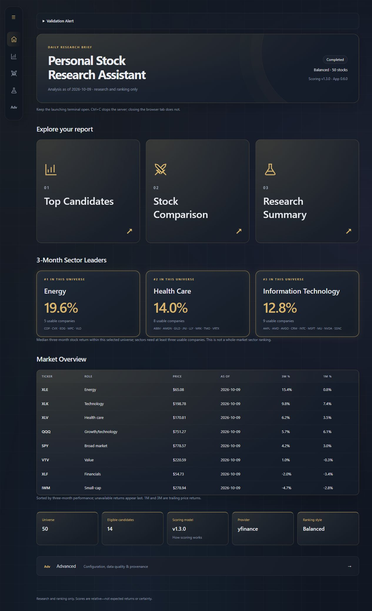
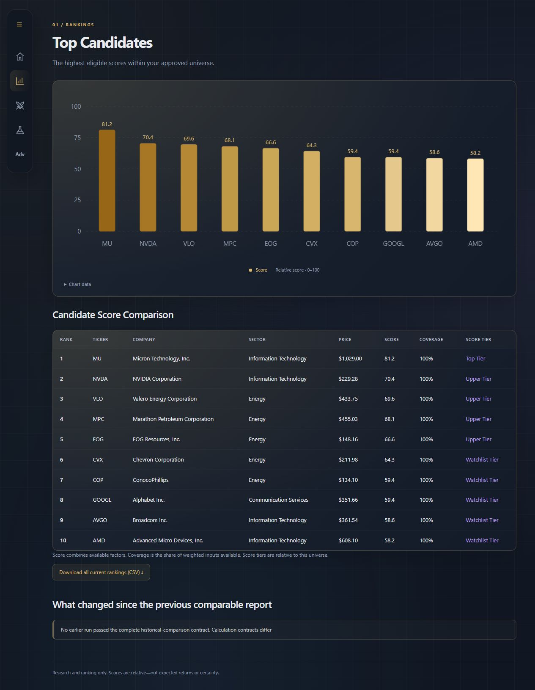
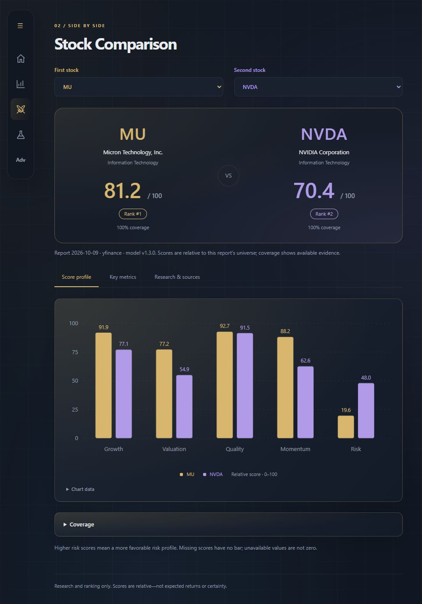
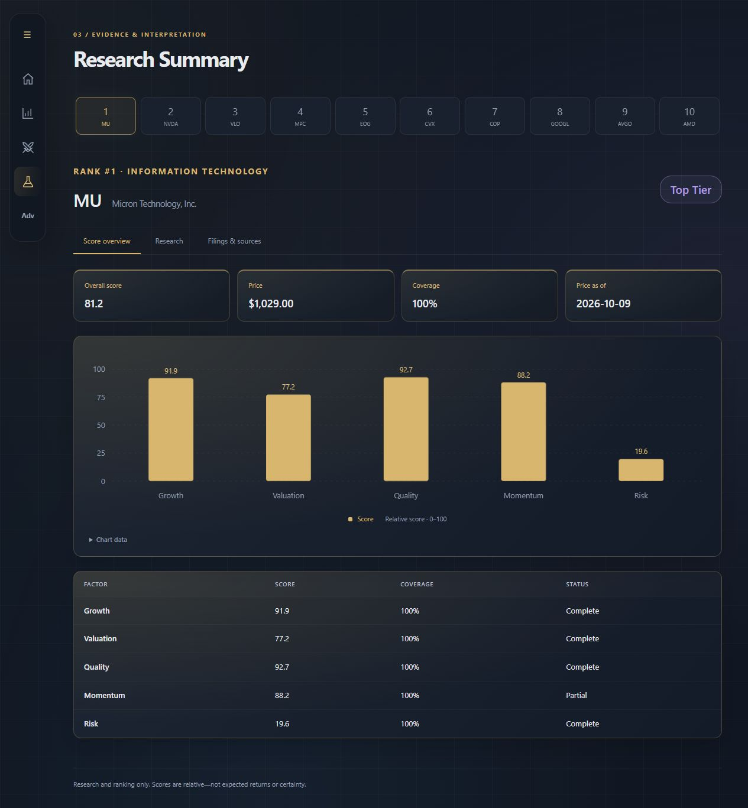
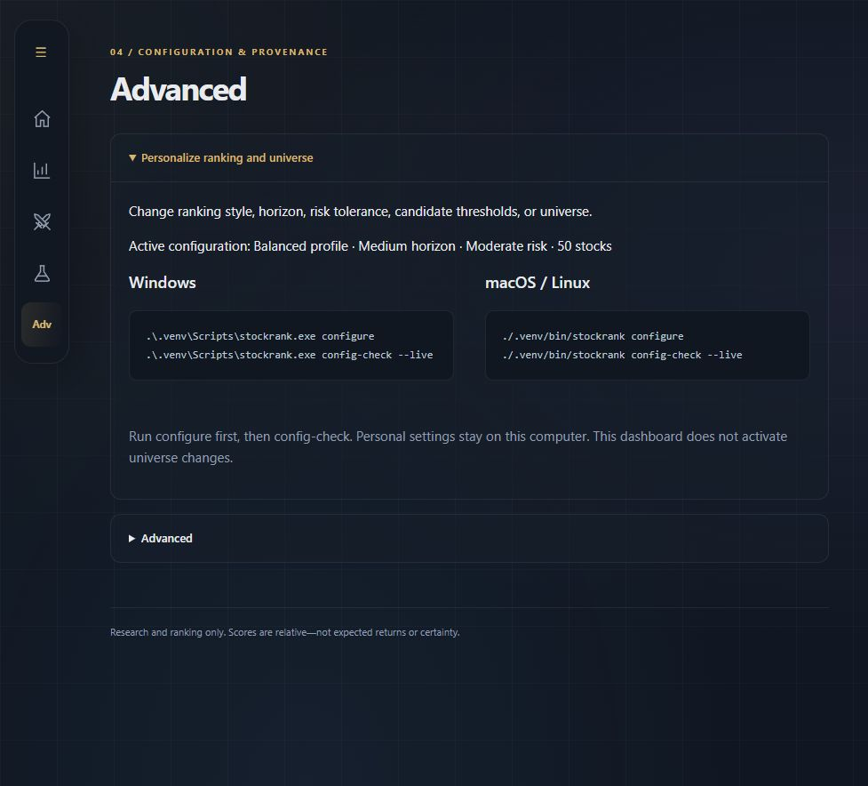

# React dashboard guide

Reviewed against application 0.6.0, commit `d458d56`, on October 13, 2026.
React is the only dashboard. The interface ships with the Python application;
normal installation and use require no Node.js or frontend build.

## Open and navigate

Use `stockrank dashboard` to open the latest saved report without fetching data or
calculating a new report. Use the executable in the project's virtual environment:

```powershell
# Windows, from the project folder
.\.venv\Scripts\stockrank.exe dashboard
```

```bash
# macOS / Linux, from the project folder
./.venv/bin/stockrank dashboard
```

The browser opens automatically at `http://localhost:8765`. Keep the terminal open;
closing a browser tab does not stop the server. Reload after generating a new
report or importing research. A reload returns to Home.

Home cards and the left navigation switch between five views within the page.
The navigation expands on hover or keyboard focus. Its three-line symbol is
decorative. Short windows can scroll the navigation to reach every view.

| View | What it shows |
|---|---|
| **Home** | Report date and status, navigation cards, sector leaders, market context, universe size and scoring model. A **Validation Alert** appears when the report has workflow warnings; expand it for details. |
| **Top Candidates** | The highest eligible scores, candidate table, all-rankings CSV download, and changes from the previous compatible report or a reason no comparison is available. |
| **Stock Comparison** | Two distinct top candidates, with **Score profile**, **Key metrics**, and **Research & sources** tabs. Coverage starts collapsed. |
| **Research** | A numbered company selector and **Score overview**, **Research**, and **Filings & sources** tabs for that saved run. |
| **Advanced** | Personalization instructions and current profile, plus expandable report evidence, data quality, source health and SEC diagnostics. |

The Home **Scoring model** card opens a dialog explaining the overall formula and
five expandable factor categories. Close, Escape or a backdrop click dismisses it.
Research and Stock Comparison charts provide calculation/time-window tooltips;
expand **Chart data** for values and fuller explanations. Large tables show at most
25 rows per page, with Previous/Next controls. CSV includes all current rankings.

## Read the evidence correctly

- Scores express relative standing within the saved universe. Coverage measures
  available weighted inputs; missing values are never displayed as zero.
- Research is populated only after a successful import for that report. The
  desktop launcher creates a deterministic base report, not AI research.
- SEC filings and financial snapshots are bounded by the saved report's cutoff.
  Older reports lacking a defensible cutoff show an explicit limitation.
- Report-linked provider comparisons and installation-current diagnostics are
  distinct. SEC shadow values do not change production rankings.
- Historical comparisons require complete, compatible calculation contracts,
  membership and ordered market-data dates. There is no arbitrary older-run picker.
- Sector leaders describe the selected universe, not whole-market sector rankings.
  Source dates, warnings and unavailable values remain visible.

The dashboard is read-only. Advanced provides commands for changing preferences;
universe approval happens in the separate [review workflow](UNIVERSE_DISCOVERY.md).

## Current screenshots

Captured from the actual React application on October 13, 2026, using an existing
Yahoo-backed report dated **October 9, 2026**. These illustrate the interface, not
current prices, investment recommendations or a newly generated report. No demo
data, fabricated research or edited values were used. The Home validation alert
and the unavailable historical-comparison explanation are retained.

### Home



### Top Candidates



### Stock Comparison



### Research



This capture shows the **Score overview** tab; it does not imply that qualitative
research has been imported.

### Advanced



The captures contain no SEC contact identity, credentials, personal filesystem
paths or raw configuration exports. Diagnostic disclosures remain available in
the application; they are not expanded in these overview images.

## Local server and packaging

`dashboard_server.py` serves bundled files from `web_assets/` and the read-only
report/CSV endpoints. It binds to `127.0.0.1`, validates Host and Origin, rejects
cross-site reads, and serves only an explicit asset allowlist. `dashboard_data.py`
reads a consistent SQLite snapshot and exposes an allowlisted public response.
Raw settings and private filesystem paths are not exported.

The CSV endpoint rejects a request if the latest report differs from the one shown.
Qualitative Markdown rejects raw HTML and remote images; source links allow HTTP(S).
No cloud host, telemetry or remote fonts are required. Do not expose the server
through a public proxy or tunnel; other local processes are not isolated from it.

`setup-check` and server startup verify `index.html`, `app.js` and `app.css`.
Missing assets require a complete installation or a frontend rebuild. The retired
Streamlit renderer and `--ui` option are no longer available.

## Frontend development

From `frontend/`, with Node.js 24 and npm:

```text
npm ci
npm test
npm run format:check
npm run build
```

On PowerShell use `npm.cmd` if execution policy blocks `npm.ps1`. Source lives in
`frontend/src`; locked dependencies and `build.mjs` generate `src/stockrank/web_assets/`.
Include rebuilt assets with approved source changes. CI checks that a rebuild
matches the committed bundle. Python wheels include the bundle and license notices.

Charts animate when entering view; reduced-motion preferences disable entry
animation and pointer tilt. Collapsed disclosures mount their contents only while
open. Reopening starts nested sections and table pages fresh.

## Terminal lifecycle

The welcome banner draws a small green line while the dashboard runs. Ctrl+C
(Control+C on Mac) stops the server and starts the blue-to-white horizon farewell.
At **Close terminal? [y/n]**, Y + Enter exits; N + Enter continues. Ctrl+C also exits
the farewell. Unsupported terminals use static art; redirected/CI output does not
wait for input. Terminal modes and cursor visibility are restored on exit.

Manual commands return to their shell. The Windows desktop launcher uses its own
Python console. On macOS, Y + Enter can close the launcher's own single-tab Apple
Terminal window; macOS may request permission to control Terminal. Other windows
and multi-tab windows are preserved. Closing a window with its X button cannot
play the farewell afterward. Preview the animation with `python -m stockrank.farewell`.

## Verification

For `d458d56`, 624 Python tests passed with four platform-specific skips, and all
20 frontend tests passed. A clean installation without Streamlit or PyArrow passed
the same Python suite. Rebuilt React assets were identical; the wheel contained
the required assets and SEC modules. All 15 [hosted CI jobs](https://github.com/nlibby17/Stock-Research-Assistant/actions/runs/38354450737)
passed. CI's compatibility profile runs on current macOS, not physical macOS 11.

This documentation refresh inspected all five views and captured the screenshots
above without running a new daily report or changing the saved universe. Earlier
presentation decisions remain in Git history and the [decision ledger](REFACTORING_REVIEW.md).
